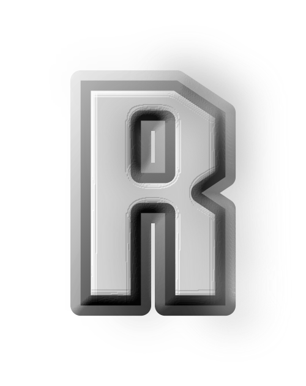

<div align="center">
  
  <h1>FreeRS42</h1>
  <h3>An open source re-implementation of Ricochet Xtreme, a classic Breakout-style PC video game.</h3>
  
</div>

Built on the [NuVelocity](https://github.com/NuVelocity/NuVelocity) engine, this project aims for accuracy, performance, extensibility, and maintainability, while recreating the with modern code and tools.

## Build Instructions

1. Install dependencies (see `engine/README.md`)
2. Clone repository and submodules
3. Configure with CMake:

```sh
cmake -S . -B build
```

4. Build:

```sh
cmake --build build
```

- Binary releases/CI artifacts from each commit are available under the **Actions** tab of this repository.

## License

Main code and engine are licensed under the Mozilla Public License 2.0 (MPL 2.0).
For third-party code, see the `third_party` directory for license information.

## Contact

For questions, open an issue. Code contribution guidelines are still being written.
